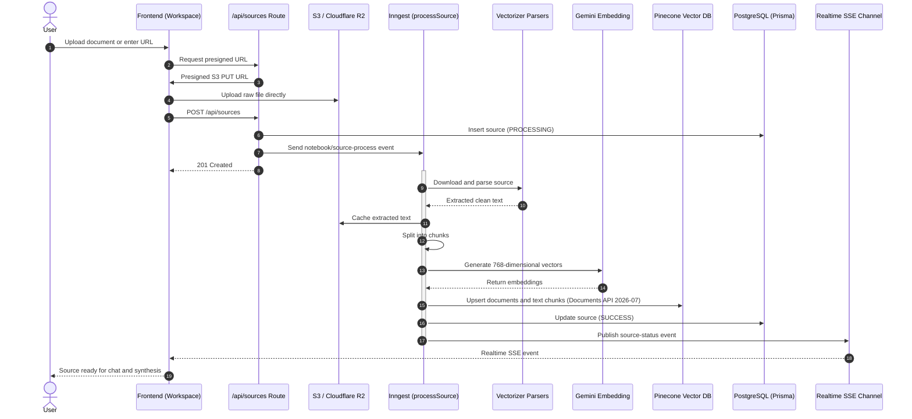
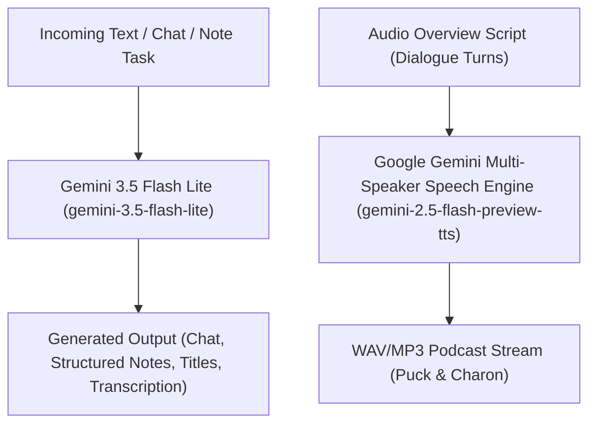
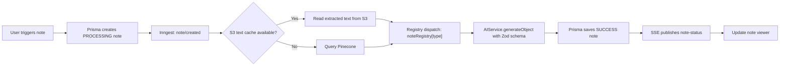
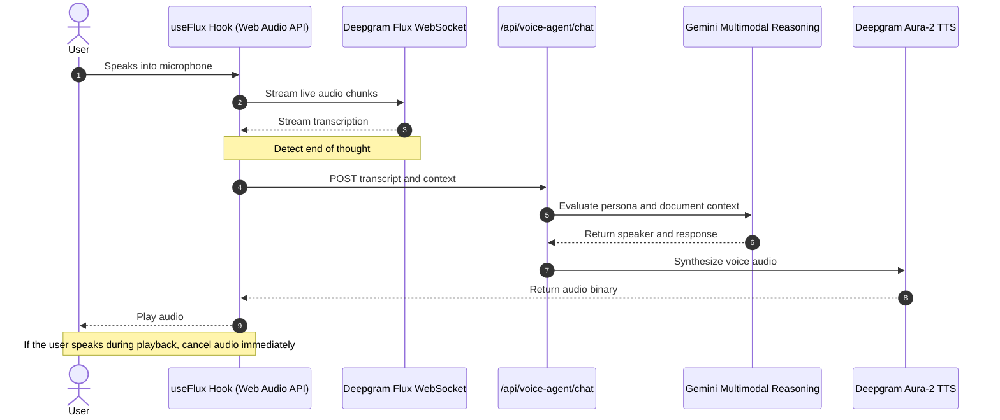
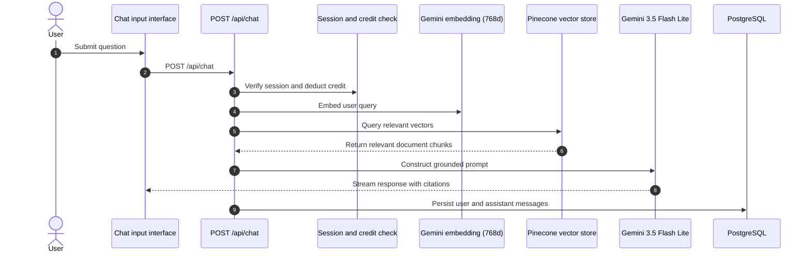

# Infera Notebook · System Architecture

This document provides a comprehensive technical overview of Infera Notebook, detailing the system design, data pipelines, model routing logic, background execution, real-time voice intelligence, and storage strategies.

---

## 🏗️ High-Level System Architecture

Infera Notebook is architected as an event-driven, serverless system optimized for ultra-low-latency interactive retrieval, high-throughput document ingestion, and multi-format content generation.

```mermaid
flowchart TD
    %% Client Layer
    subgraph Client["Client Layer - Next.js 16 / React 19"]
        UI["Workspace UI / Notebook Shell"]
        ChatUI["Semantic Chat & Citations"]
        NotesUI["12 Dynamic Note Renderers"]
        VoiceUI["Flux Voice Agent / Gemini Live UI"]
        RemotionPlayer["Remotion Video Player"]
    end

    %% API Layer
    subgraph Server["Next.js Server & Route Handlers"]
        AuthMiddleware["Better Auth & Session Guard"]
        APIRouter["API Route Handlers"]
        CreditService["Credit & Quota Manager"]
        ChatAPI["/api/chat - RAG Streaming"]
        LiveAPI["/api/live/config - Ephemeral Tokens"]
        VoiceAPI["/api/voice-agent/chat - Turn Dispatch"]
        S3API["/api/s3 - Presigned Upload URLs"]
        SourceAPI["/api/sources - CRUD & Trigger"]
    end

    %% Background Processing
    subgraph Background["Durable Background Workers - Inngest"]
        InngestBus["Inngest Event Bus"]
        WorkerSource["processSource Worker"]
        WorkerNote["createNote Worker"]
        RealtimePubSub["Inngest Realtime SSE / Pub-Sub"]
    end

    %% Storage
    subgraph Storage["Persistence & Object Stores"]
        Postgres[("Neon PostgreSQL / Prisma ORM")]
        Pinecone[("Pinecone Documents API - 2026-07")]
        BlobStorage[("Cloudflare R2 / AWS S3")]
        TextCache[("S3 Extracted-Text Cache")]
    end

    %% AI and Speech
    subgraph AI["AI & Speech Intelligence"]
        GeminiModel["Gemini 3.5 Flash Lite Engine"]
        Embeddings["Gemini Embeddings - 768d"]
        DeepgramASR["Deepgram Flux ASR / Nova-3 STT"]
        DeepgramTTS["Deepgram Aura-2 TTS"]
        AssemblyAI["AssemblyAI Speech Intelligence"]
        GeminiLiveWS["Gemini Live API WebSocket"]
    end

    %% Client to API
    UI --> AuthMiddleware
    ChatUI --> ChatAPI
    NotesUI --> APIRouter
    VoiceUI --> VoiceAPI
    VoiceUI <--> GeminiLiveWS

    %% API routing
    AuthMiddleware --> APIRouter
    APIRouter --> CreditService
    APIRouter --> ChatAPI
    APIRouter --> LiveAPI
    APIRouter --> VoiceAPI
    APIRouter --> S3API
    APIRouter --> SourceAPI

    %% API to database and storage
    CreditService --> Postgres
    ChatAPI --> Postgres
    ChatAPI --> Pinecone
    ChatAPI --> GeminiModel
    SourceAPI --> Postgres
    SourceAPI --> InngestBus
    S3API --> BlobStorage
    LiveAPI --> GeminiLiveWS

    %% Background source processing
    InngestBus --> WorkerSource
    WorkerSource --> BlobStorage
    WorkerSource --> TextCache
    WorkerSource --> Embeddings
    Embeddings --> Pinecone
    WorkerSource --> Postgres
    WorkerSource --> RealtimePubSub

    %% Background note generation
    InngestBus --> WorkerNote
    WorkerNote --> TextCache
    WorkerNote --> Pinecone
    WorkerNote --> GeminiModel
    WorkerNote --> Postgres
    WorkerNote --> RealtimePubSub

    %% AI execution
    VoiceAPI --> GeminiModel
    VoiceAPI --> DeepgramTTS

    %% Voice processing
    VoiceUI <--> DeepgramASR
    VoiceUI <--> DeepgramTTS
    VoiceUI <--> AssemblyAI

    %% Realtime updates
    RealtimePubSub --> UI
```

---

## 📥 Ingestion & Multi-Format Vectorization Pipeline

When a user adds a source, it undergoes asynchronous parsing, text extraction, caching, chunking, and embedding. Sixteen distinct source types are supported through dedicated vectorizers.

### Supported Vectorizer Loaders

| Source Category         | Parser Implementation             | Details                                        |
| ----------------------- | --------------------------------- | ---------------------------------------------- |
| PDF                     | `pdf-parse` / LangChain PDFLoader | Extracts text and handles multi-column layouts |
| Word (.docx)            | `mammoth` / `word-extractor`      | Preserves headers and body text                |
| PowerPoint (.pptx)      | `officeparser`                    | Extracts slide text and presenter notes        |
| EPUB                    | `epub2`                           | Parses chapters and narrative                  |
| Text (.txt)             | LangChain TextLoader              | UTF-8 stream processing                        |
| Data (CSV, JSON, JSONL) | LangChain DataLoaders             | Structured data extraction                     |
| Subtitles (.srt)        | `srt-parser-2`                    | Normalizes timestamps and dialogue blocks      |
| Audio                   | Deepgram Nova-3 / AssemblyAI      | Speech-to-text and speaker diarization         |
| Video                   | Audio extraction + Deepgram       | Transcribes audio tracks                       |
| Websites                | Tavily Extract (`@tavily/core`)   | Extracts Markdown and removes boilerplate      |
| GitHub repositories     | LangChain GithubLoader            | Ingests source code and Markdown documentation |

---

## 🧠 Unified AI Model & Speech Architecture

The AI layer is structured around specialized Google Gemini models:

1. **Unified Text & Synthesis Engine**: All conversational chat, streaming, reasoning, structured note synthesis, title generation, and transcription use **Gemini 3.5 Flash Lite** (`gemini-3.5-flash-lite`) for fast, consistent execution and high-fidelity output.
2. **Multi-Speaker TTS Engine**: Multi-speaker podcast synthesis uses **Gemini 2.5 Flash Preview TTS** (`gemini-2.5-flash-preview-tts`). The generator structures conversational script turns as discrete content parts with `speech_metadata.speaker` annotations paired with `speechConfig.multiSpeakerVoiceConfig.speakerVoiceConfigs` (e.g., `Puck` and `Charon`), ensuring distinct, realistic studio host voices.
3. **Batched Embeddings**: Google `gemini-embedding-2` produces 768-dimensional Matryoshka Representation Learning (MRL) embeddings. Ingestion batches calls (up to 96 documents per request) with exponential backoff to respect the 100 RPM limit.

---

## 📝 Asynchronous Note Generation Engine

Notes are generated through an isolated background pipeline to prevent HTTP timeouts and preserve UI responsiveness.

### Note Type Implementations & UI Registry

Note creation actions are organized in the workspace into quick-access buttons (Study Guide, Audio Overview, Mind Map) and an extensible **Report** dropdown menu:

| Note Type        | UI Menu Placement           | Handler or Implementation      | Generation Output                                 |
| ---------------- | --------------------------- | ------------------------------ | ------------------------------------------------- |
| `EDITABLE_NOTE`  | Top-level / Convert         | User-created or converted      | BlockNote block JSON                              |
| `CHAT_NOTE`      | Chat action                 | `/api/chat` save action        | Markdown conversation record                      |
| `AUDIO_OVERVIEW` | Quick Action                | `src/lib/notes/audio-overview` | Dialogue script and multi-speaker TTS audio       |
| `MIND_MAP`       | Quick Action                | `src/lib/notes/mindmap`        | XYFlow graph specification                        |
| `FAQ`            | Report Menu                 | `src/lib/notes/faq`            | Questions, answers, and categories                |
| `TIMELINE`       | Report Menu                 | `src/lib/notes/timeline`       | Dates, titles, and descriptions                   |
| `BRIEFING_DOC`   | Report Menu                 | `src/lib/notes/briefing`       | Executive summary, findings, and recommendations  |
| `QUIZ`           | Quick Action (Study)        | `src/lib/notes/quiz`           | Questions, options, answers, and explanations     |
| `FLASH_CARDS`    | Quick Action (Study)        | `src/lib/notes/flash-cards`    | Front, back, and category fields                  |
| `SLIDE_DECK`     | Report Menu _(Coming Soon)_ | `src/lib/notes/slide-deck`     | Slides, bullets, and speaker notes                |
| `INFOGRAPHIC`    | Report Menu _(Coming Soon)_ | `src/lib/notes/infographic`    | Data sections, metrics, and visual hierarchy      |
| `VIDEO_OVERVIEW` | Report Menu _(Coming Soon)_ | `src/lib/notes/video-overview` | Synchronized slides, audio, and Remotion metadata |

---

## 🎙️ Dual Real-Time Voice Intelligence

Infera Notebook implements two complementary voice architectures.

### 1. Deepgram Flux ASR & Aura-2 TTS

Designed for conversational Q&A where users discuss document content with custom AI personas.

### 2. Gemini Live API

Uses a direct WebSocket connection for low-latency, bidirectional, multimodal voice conversations.

- Ephemeral session tokens are generated through `/api/live/config`.
- `GeminiLiveAPIClient` manages connections in `src/lib/llm/live-api-client.ts`.
- Supports full-duplex audio input, audio output, and interruption detection.

---

## 🔍 Semantic Search & RAG Chat Pipeline

The interactive chat system balances retrieval accuracy, token efficiency, and response latency.

---

## 🏛️ Data Storage & Security Model

### Persistence Layer

1. **Relational database (Neon PostgreSQL)**
   - Managed using Prisma ORM and a PostgreSQL adapter.
   - Core entities include `User`, `Session`, `Account`, `Verification`, `Notebook`, `Source`, `File`, `Note`, `Chat`, and `Message`.
   - Foreign-key cascades support deletion of related sources, notes, and messages.

2. **Vector store (Pinecone Documents API `2026-07`)**
   - High-performance serverless document index with 768 dimensions and integrated text storage.
   - Built on Pinecone's native Documents REST API (`X-Pinecone-API-Version: 2026-07`), eliminating heavy vector-store wrappers.
   - Flat document schema (`_id`, `chunk_text`, `title`, and notebook/source metadata) storing chunk text directly in the index.
   - Namespace normalization (`normalizeNamespace()` mapping empty namespace to `'default'`).
   - Integrated semantic scoring (`score_by: [{ type: 'embed', field: 'chunk_text', query }]`) and filtered batch deletion.

3. **Object storage (Cloudflare R2 / AWS S3)**
   - Stores uploaded files, cached extracted text, and generated audio/video.
   - Presigned URLs allow direct media transfers without proxying files through Next.js.

### Security & Access Control

- **Authentication:** Better Auth with HTTP-only session cookies and Google OAuth.
- **IDOR protection:** API routes verify notebook and source ownership before reading or modifying records.
- **Quota and credit protection:** Daily-resetting credits help control API usage.
- **Input validation:** Zod schemas validate endpoint payloads before execution.
